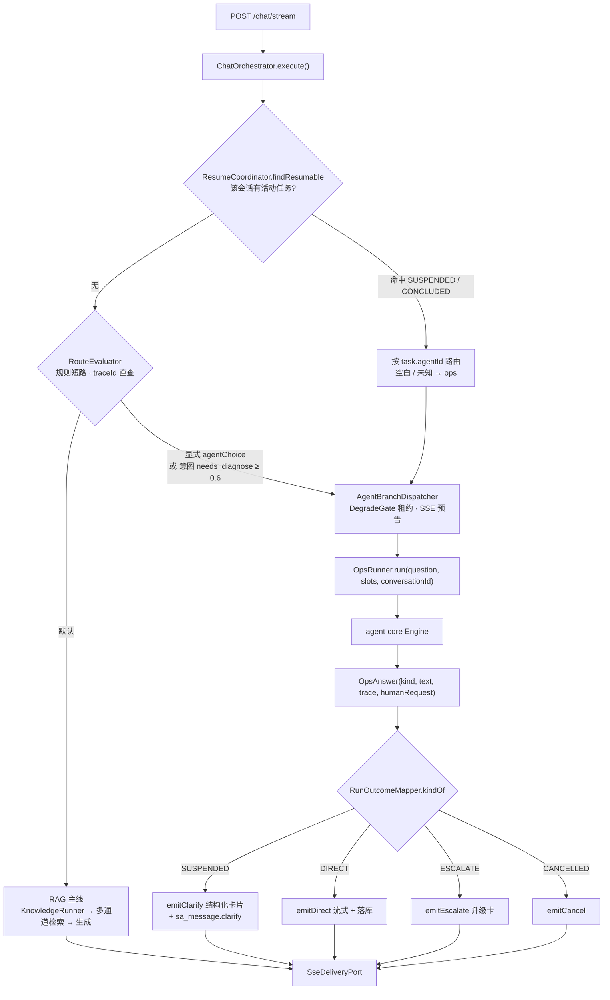
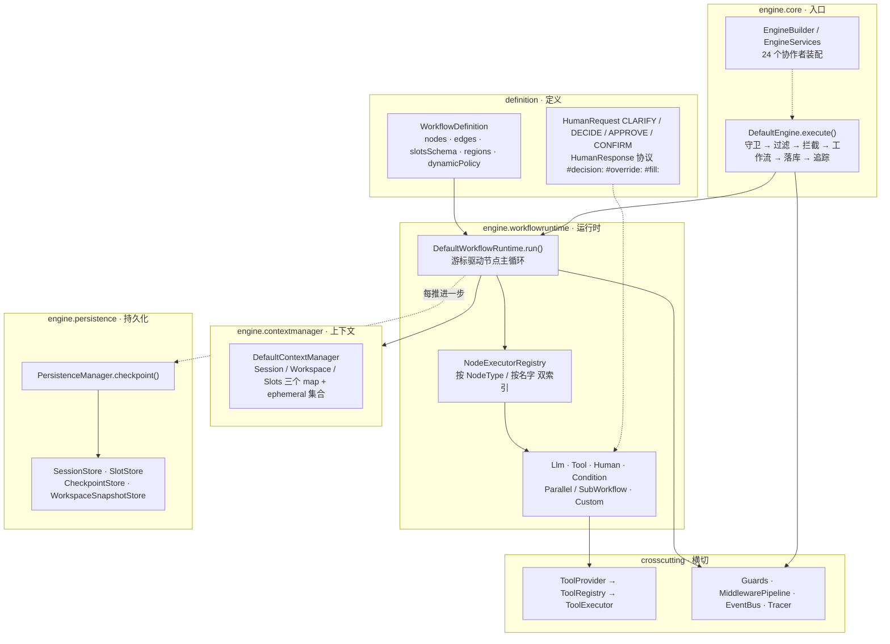
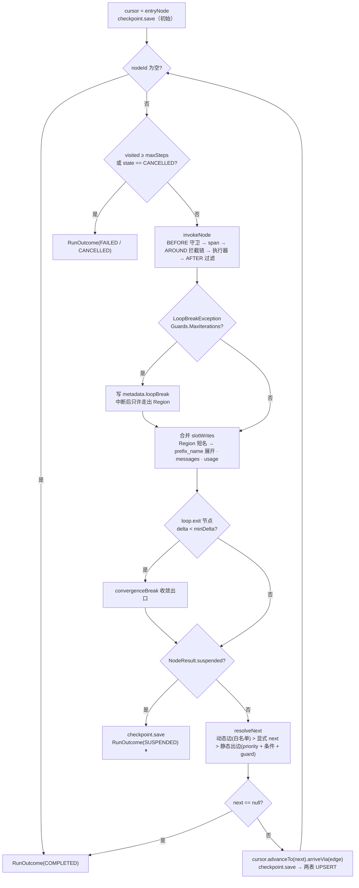
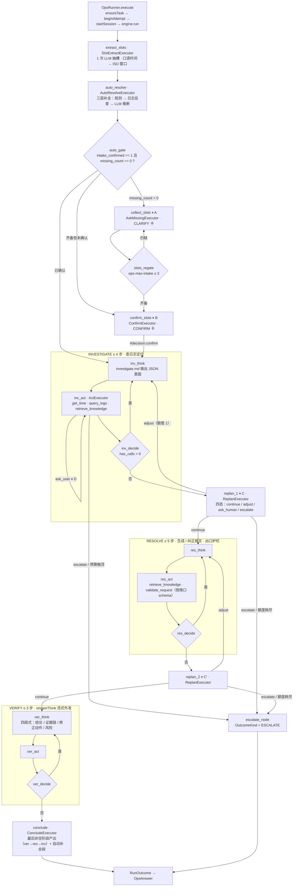
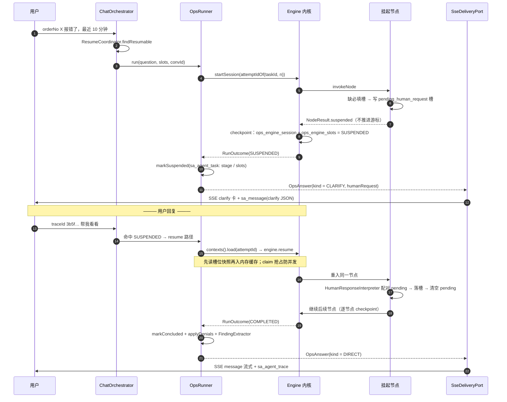
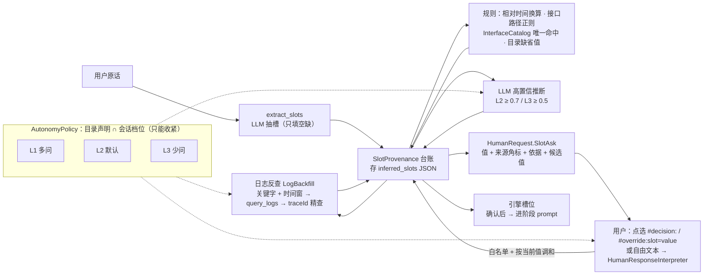
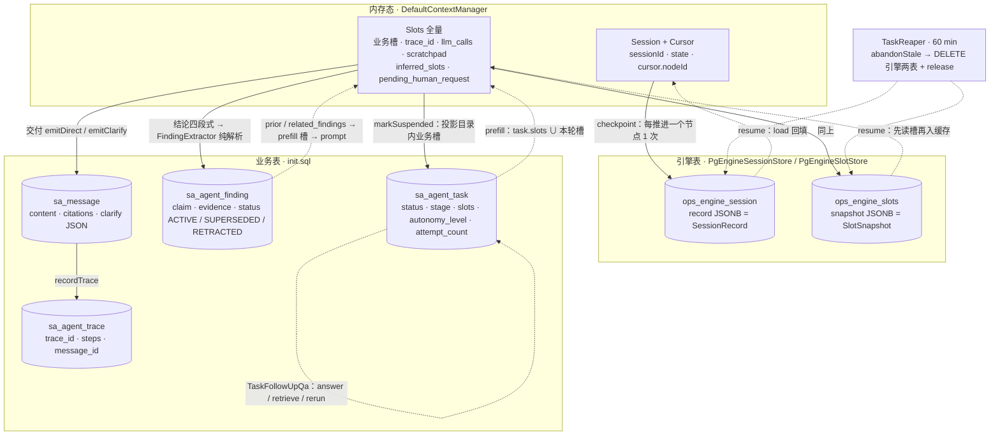

# Agent 内核 / 诊断业务 / 数据流转 流程图

> 代码为准（2026-09-21）。注意：CLAUDE.md 决策 4 中的 `ToolLoopEngine` / `StageSpec` / `LoopExitChecks` / `JsonToolCallAdapter` 等类名在当前代码中**已不存在**（属旧业务层内核），本图按真实落点绘制。

## 1. 总览：一条用户消息如何分流

## 2. 内核分层结构（platform-agent-core）

## 3. 运行时：节点主循环与出口判定

## 4. 诊断业务图：ops_diagnose_v2

挂起点：**A** 缺必填槽 · **B** 待确认 · **C/C'** replan 决策移交 · **D** 阶段内 `ask_user`（任一阶段 act 均可）。统一落 `NodeResult.suspended` + `pending_human_request`。

## 5. 挂起 → 恢复 时序

## 6. 槽位：来源与流转

来源状态机：`rule → default → llm → log_query → user_override（终态）`。

## 7. 数据落库与流转

| 补充 | 说明 |
|---|---|
| `sa_agent_session` | 已被 `sa_agent_task` 取代，代码零读写，仅存历史行 |
| `ephemeral` | REST 单轮诊断 / 知识问答：`persist` 与逐节点 checkpoint 双处拦截，不落引擎表 |
| 回收开关 | `engine-retention-hours ≤ 0` 时只统计不删 |
| Workspace | 全仓不持久化（`WorkspaceSnapshotStore.load` 零调用） |
| 无 compaction | 等价物是 `ActExecutor.truncateObservation`（观测截断 4000 字符） |
