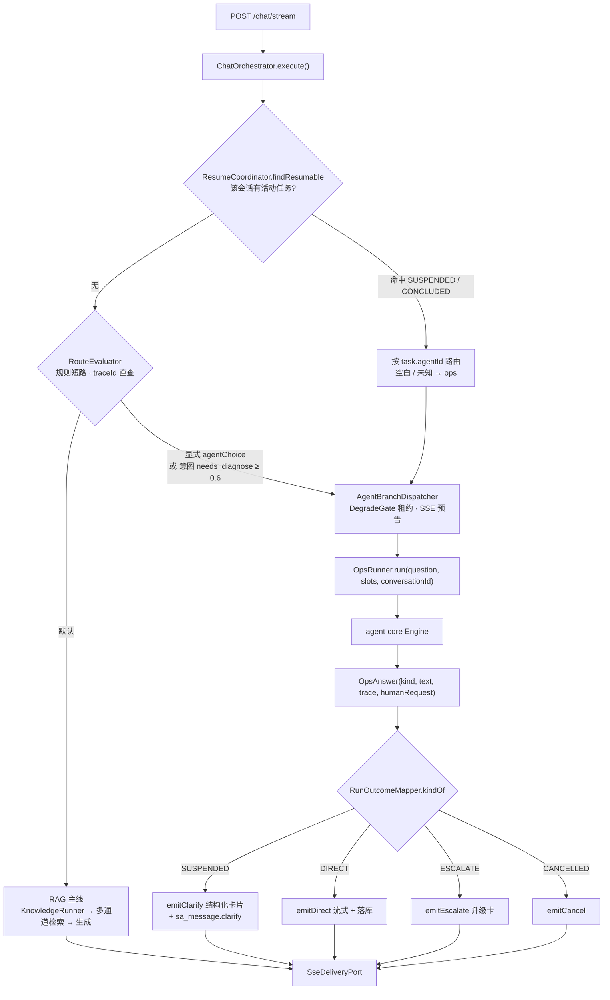
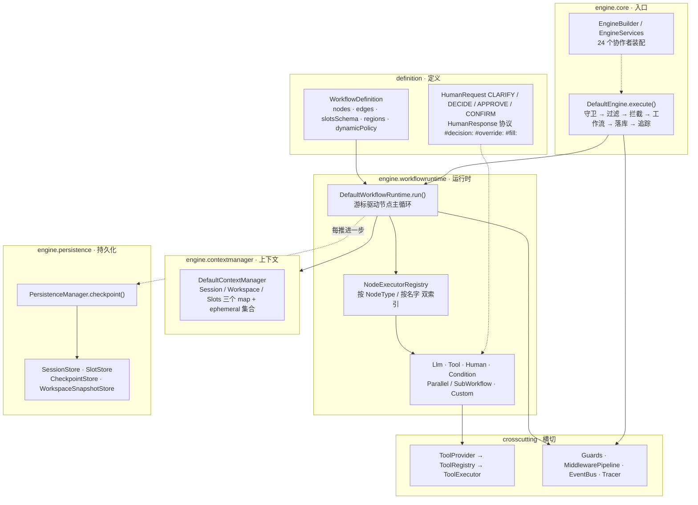
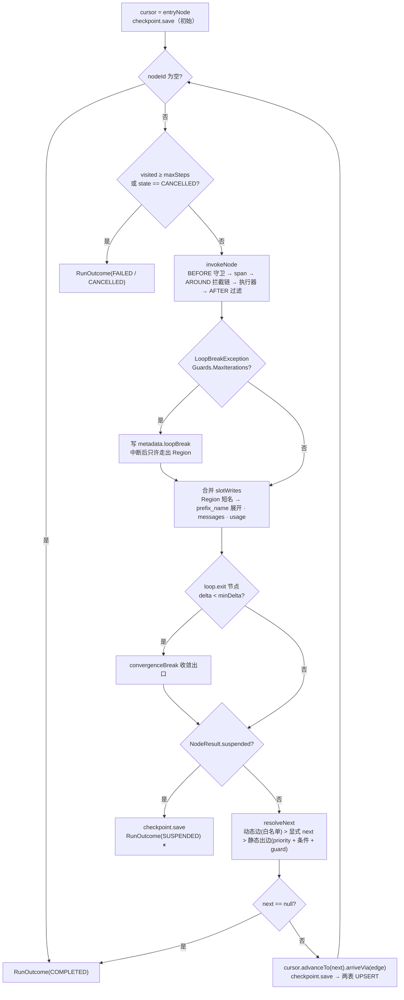
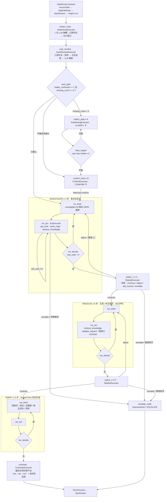
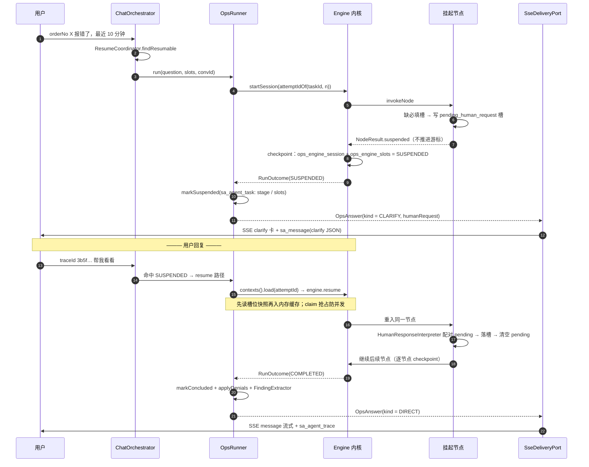
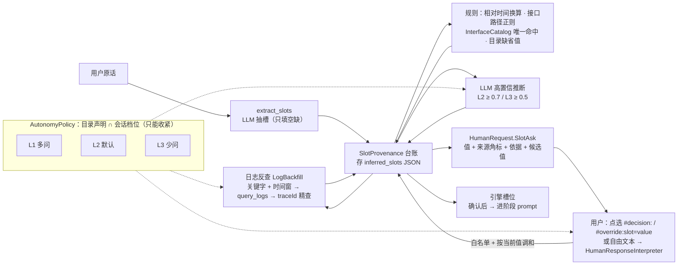
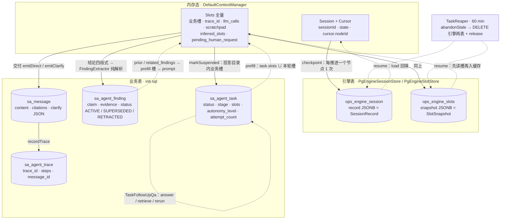

# 架构与结构规范（customer-platform）

> 2026-10-11 文档整理：本文由三份文档合并而成，原文完整保留，各部分以 `---` 分隔。
>
> - 第一部分 · 项目结构与命名规范（16 模块分层、包/类名规范、构建验证）
> - 第二部分 · Agent 内核 / 诊断业务 / 数据流转流程图（mermaid 图集）
> - 第三部分 · Agent/Chat 层重建规格（功能记录与验收基准 F/O/T/E/P/B）

---

<!-- 原文件：docs/project-structure.md -->

# 项目结构与命名规范（2026-09-12 定稿）

## 1. 总体结构：16 个 Maven 模块，单向成层

```
customer-platform（root pom，groupId com.jjx.customer，包根 com.jjx.customer.platform）
│
├── 框架层（可复用，零业务依赖）
│   └── platform-agent-core                内核（包根 com.agentframework，自 agent-framework 仓库整包并入，见
│                                          本文「Agent/Chat 层重建规格」§9）：engine（引擎/构建器/执行器 SPI）/
│                                          definition（workflow/node/agent/tool/region 声明）/ crosscutting（cache/guard/
│                                          filter/interceptor/trace/metrics）/ runtime（session/slot/event/persistence）/
│                                          infra（modelgateway/storage）/ extension / sdk
│
├── 基础设施层
│   ├── platform-common                    通用：util / mybatis 类型处理器 / 分页 DTO（最底层，无域依赖）
│   └── platform-shared                    共享：配置属性 / Prompt 加载 / 模型与 OkHttp 装配 / VlmClient +
│                                          跨域 SPI 契约：delivery · conversation · document · routing · intent · clarify
│
├── 能力域层
│   ├── platform-cache                     缓存：CacheStore / Redis 装配 / 频率准入 / 语义缓存基础设施
│   ├── platform-observe                   观测：OpenObserve / Langfuse / TraceSampling 装配
│   ├── platform-storage                   存储：S3 对象存储 + 文件元数据
│   ├── platform-knowledge                 知识：多通道检索 / 融合 / 重排 / 后处理 + RAG 生成（KnowledgeAnswerService）
│   ├── platform-prompt                    Prompt：资产化 / 版本 / 能力包与绑定 / prompts 资源
│   └── platform-ingestion                 入库：解析 / 分块 / 增强 / 富化 + 文档目录（DocumentCatalog 实现）
│
├── 业务层（调度 + 交付）
│   ├── platform-business                  业务/调度（2026-09-19 重排，RAG 线与诊断线顶层分域）：
│   │                                      engine/（agent-core 桥接：AgentEngineConfiguration 装配、AgentCatalog、
│   │                                        adapter/persistence/outcome 子包）
│   │                                      workflow/common/（两域共用节点执行器：ActExecutor、EscalateExecutor、EscalateTerminal）
│   │                                      knowledge/（RAG 线全部：KnowledgeRunner、workflow/ 双图工厂、node/ 七个执行器、
│   │                                        intent/、normalize/、rag/）
│   │                                      ops/（诊断线全部：OpsRunner、人在环中（HumanResponseInterpreter 回复解释器 /
│   │                                        AutonomyLevel+AutonomyPolicy 自主档位）、workflow/ 图工厂+stages、
│   │                                        node/、slot/（SlotProvenance 槽位来源）、tool/、rest/）
│   │                                      orchestration/（ChatOrchestrator 决策骨架 + 8 个协作类，纯跨域调度）/
│   │                                      routing / runtime（DegradeGuard）/ session / trace / telemetry / agent/schemas 资源
│   ├── platform-delivery                  交付通道：sse（端口实现 + 事件协议）/ message（会话消息持久化）/
│   │                                      runtime（活动流注册表）/ service（入口薄壳）/ rest
│   ├── platform-mcp                       MCP 接入：外部扩展工具来源
│   └── platform-eval                      评测：数据集 / 跑批 / 指标 / 对照 / 外部推送
│
└── 收口
    ├── platform-console                   控制台视图 / 全局异常 / ping / AgentRegistry
    └── platform-bootstrap                 唯一可执行装配点：启动类 / application*.yaml / sql / static / OpenApi
```

### 一次 RAG 请求的调用链（先看这条链，再看模块）

```
POST /chat/stream
 └─ delivery.rest.ChatController                      通道入口（SSE 载体）
     └─ delivery.service.ChatService → business.orchestration.ChatOrchestrator.execute(…, sink)
         ├─ 决策链：会话恢复 → 归一化 → 规则短路 → 显式范式 → 指代悬空 → 意图分类 → 规则路由
         │   （决策骨架在 ChatOrchestrator；各步实现体在 orchestration/ 的 8 个协作类）
         ├─ ops 支路：framework agent + workflow（ops.OpsRunner，经 AgentBranchDispatcher 分派）→ Outcome 分派（追问/直答/升级）
         └─ RAG 主线：
             ├─ conversation.ConversationStore.historyContext（会话事实）
             ├─ knowledge.normalize.QueryRewriter（LLM 改写）
             ├─ knowledge.KnowledgeRunner（agent + workflow；检索 = extension tool，执行权在框架引擎）
             │   ├─ knowledge.retrieval（多通道检索 / 重排 / 后处理 + 两级答案缓存）
             │   └─ knowledge.answer.KnowledgeAnswerService（流式生成）
             ├─ knowledge.rag.RagContextAssembler（上下文文本 + 引用溯源映射）
             └─ delivery.DeliveryPortFactory → delivery.sse.SseDeliveryPort
                 ├─ sse.SseEventSender（message / trace / citations / clarify / meta 事件协议）
                 └─ message.ChatMessageWriter（sa_conversation / sa_message 读写）
```

### 跨域 SPI 一览（接口在 shared，实现在能力/交付模块）

| SPI（platform-shared） | 作用 | 实现 |
|---|---|---|
| `platform.delivery.DeliveryPort` / `DeliveryPortFactory<S>` | 交付通道（事件、落库、流生命周期） | `delivery.sse.SseDeliveryPort` / `SseDeliveryPortFactory` |
| `platform.conversation.ConversationStore` | 会话事实读写（历史、先行对象） | `delivery.message.ChatMessageWriter` |
| `platform.document.DocumentCatalog` | 文档目录（文档名、原文链接） | `ingestion.catalog.IngestionDocumentCatalog` |
| `platform.routing.RouteRegistry` / `RouteRule`、`platform.intent.IntentResult`、`platform.clarify.*` | 路由 / 意图 / 澄清契约 | business 侧规则与实现 |

### 依赖方向（硬约束）

```
bootstrap → 业务域（business / delivery / eval）→ 能力域（knowledge / prompt / observe / cache / storage / ingestion）
          → platform-shared → platform-common
business → knowledge（RAG 能力）；delivery → business（编排入口）；eval → business / delivery（跑批与对照）
业务域之间不直接 import 具体实现；跨域只经上表 SPI 或 shared 中立契约
唯一汇总点：platform-bootstrap（只有它允许依赖全部模块）
```

| 规则 | 说明 |
|---|---|
| 框架零业务依赖 | `platform-agent-core`（com.agentframework）不含任何 `platform-*` 业务模块依赖 |
| 编排层不碰传输 | `ChatOrchestrator` 内不出现 `SseEmitter` / `SseEventSender` / `MessageMapper`（只依赖 shared SPI） |
| 交付层不做决策 | `platform-delivery` 不判断意图/路由/检索，只执行"怎么送到用户" |
| 路由/意图契约中立 | `platform.routing`、`platform.intent` 在 shared，business 与 eval 都依赖它，避免环 |
| 检索感知的缓存类归 knowledge | `CacheKeys` / `CachingRetrievalEngine` / `SemanticAnswerCache` / `DocumentVersionStamp` |
| 资源随域走 | `prompts/**` 在 platform-prompt；`agent/schemas/**` 在 platform-business |
| 跨模块测试复用 | `platform-cache` 产出 test-jar（`FakeCacheStore`），按 `test` scope 依赖 |

## 2. 包与命名规范

### 2.1 包名

- 根包：`com.jjx.customer.platform`；框架：`com.agentframework`（platform-agent-core，刻意与业务包根分离）。
- 全小写、单数、领域名词；禁用缩写暗号（`fw`、`mgr`、`util2`）。
- 分层后缀固定：`orchestration`（编排决策）/ `domain`（数据）/ `runtime`（装配与运行）/ `session|trace|message`（持久化）/ `rest`（对外接口）/ `sse`（SSE 通道细节）。

### 2.2 类名后缀

| 后缀 | 含义 | 示例 |
|---|---|---|
| `Agent` / `Workflow` | 框架契约实现 | `AgentDefinition`、`WorkflowDefinition`（agent-core）|
| `Tool` | 工具能力（单一内核契约） | `RetrievalTool`、`QueryLogsTool` |
| `Rule` / `Strategy` | 路由 | `TraceIdShortCircuitRule`、`OpsIntentRouteRule` |
| `Runner` | 一次执行的适配器 | `KnowledgeRunner`、`OpsRunner` |
| `Orchestrator` | 一次请求的编排决策 | `ChatOrchestrator` |
| `Port` / `Store` / `Catalog` | 跨域 SPI 契约（shared） | `DeliveryPort`、`ConversationStore`、`DocumentCatalog` |
| `Controller` / `Service(+Impl)` / `Mapper` / `Entity` | 分层构件 | `ChatController`、`AgentTraceServiceImpl` |
| `Config` / `Properties` | 装配与配置 | `RedissonConfig`、`ChatProperties` |
| `Request` / `Response` | 传输对象 | `DiagnoseResponse` |

### 2.3 配置键例外

`rag.chat.agent.*` 等**配置键保持不变**（@ConfigurationProperties / @Value / yaml 同步），
不随包名或模块名调整，避免破坏线上配置与环境变量。

## 3. 构建与验证

```bash
export JAVA_HOME=D:/03_developtools/02_jdk/ms-21.0.11   # 必须用该 JDK（Temurin 21.0.11 在本机 javac 会致命错误）
mvn -o -s .mvn-settings.xml clean test
```

判定标准：**16 个模块 BUILD SUCCESS，测试全绿**（分模块测试数见各模块 `target/surefire-reports`）。

---

<!-- 原文件：docs/agent-architecture-flow.md -->

# Agent 内核 / 诊断业务 / 数据流转 流程图

> 代码为准（2026-09-21）。注意：CLAUDE.md 决策 4 中的 `ToolLoopEngine` / `StageSpec` / `LoopExitChecks` / `JsonToolCallAdapter` 等类名在当前代码中**已不存在**（属旧业务层内核），本图按真实落点绘制。

## 1. 总览：一条用户消息如何分流



## 2. 内核分层结构（platform-agent-core）



## 3. 运行时：节点主循环与出口判定



## 4. 诊断业务图：ops_diagnose_v2



挂起点：**A** 缺必填槽 · **B** 待确认 · **C/C'** replan 决策移交 · **D** 阶段内 `ask_user`（任一阶段 act 均可）。统一落 `NodeResult.suspended` + `pending_human_request`。

## 5. 挂起 → 恢复 时序



## 6. 槽位：来源与流转



来源状态机：`rule → default → llm → log_query → user_override（终态）`。

## 7. 数据落库与流转



| 补充 | 说明 |
|---|---|
| `sa_agent_session` | 已被 `sa_agent_task` 取代，代码零读写，仅存历史行 |
| `ephemeral` | REST 单轮诊断 / 知识问答：`persist` 与逐节点 checkpoint 双处拦截，不落引擎表 |
| 回收开关 | `engine-retention-hours ≤ 0` 时只统计不删 |
| Workspace | 全仓不持久化（`WorkspaceSnapshotStore.load` 零调用） |
| 无 compaction | 等价物是 `ActExecutor.truncateObservation`（观测截断 4000 字符） |

---

<!-- 原文件：docs/agent-rebuild-spec.md -->

# Agent/Chat 层重建规格（功能记录，2026-09-12）

## 0. 定位

本文件**只记录功能与验收口径**，不记录旧实现结构。旧 agent 实现（`chat/agent/core|workflow|slot|tools|impl|registry`
与业务 `ToolLoopEngine`）允许整体删除，按 `docs/plans/platform-refactor.md`（Agent × Workflow 目标态设计）的新框架重建；
重建完成的判据是本文 §2 的功能清单逐条可用 + §6 不变量成立。

框架侧已就绪（`D:\04_projects\agent-framework`，core + engine，无 starter）：
Agent/Workflow 组合、路由归引擎、能力三方模型、统一出口与元数据接口、工具二分、
节点形态（LOOP / DETERMINISTIC / AGENT_CALL / 可注册）、三层 Prompt 增强、Schema 护栏、预算、子 Agent 重入。
业务侧已切换：对话缺省问答路径、eval knowledge 轴。

## 1. 重建范围

| 域 | 处理 |
|---|---|
| 对话问答链路（意图/路由/检索/流式/引用/缓存） | **重建**在框架上（部分已切换） |
| ops 诊断链路（槽位/会话/阶段/replan/工具） | **重建**（前置：原生工具循环 ModelPort） |
| eval（数据集/跑批/指标/对照） | **重建**（knowledge 轴已切框架） |
| trace/观测/会话持久化 | 保留数据结构与接口，实现改为框架 SPI 适配 |
| 入库/解析/分块链路 | 不在本次范围（保持不动） |
| 前端页面与接口 | 保留功能，字段随重建结果核对后调整 |

## 2. 功能清单（重建验收基准）

编号规则：F-对话、O-ops、E-eval、P-prompt、B-基础设施。

### F 对话问答

| 编号 | 功能 | 关键行为 | 验收 |
|---|---|---|---|
| F1 | 流式问答 | 资料进 user、规则进 system；SSE 分段输出；落库 assistant 消息；结束发 meta（messageId/traceId/范式） | 同一问题输出与改造前一致；断连可取消 |
| F2 | 意图分类 | 输出 `domain/confidence/needs_web_search/reason`；域清单 = 基础域 + 各 Agent 注册的域描述动态拼装；失败兜底 knowledge | 分类异常不阻断；新域只需注册 |
| F3 | 查询归一化与改写 | 规则归一化（空格/标点/全半角）→ 历史上下文 → LLM 改写；改写失败回退规则结果 | 缓存 key 用规则归一化问题（读写同源） |
| F4 | 闲聊/问候短路 | 非检索域直接回复，不走检索与改写 | 问候不触发检索 |
| F5 | 悬空指代澄清 | "这篇文档"类指代在会话中无先行对象时反问 | 不静默取检索第一名 |
| F6 | 答案缓存（两级） | exact：规则归一化问题 + 范式 + docver + prompt 指纹；频率准入后才写；TTL 按热度缩放；语义层命中回写 exact 并联动计数 | 改 prompt/换范式/重灌文档自动失效 |
| F7 | 检索与意图缓存 | 检索 key 含 SearchContext 全参数 + docver；意图 key 带口径版本 | 参数不同不串味 |
| F8 | 引用溯源 | 命中片段按文档分组、编号 `[ref=N]`；流式前下发 citations 事件；正文 `[N](#cite-N)` 可溯源 | 引用与正文编号一一对应 |
| F9 | 显式范式选择 | 用户显式选择范式（workflow 型）跳过意图分类直达；检索型走问答链 | 选择不被意图覆盖 |
| F10 | trace 事件 | 执行轨迹（步骤/耗时/工具次数/LLM 次数）在流式前一次性下发；落库 agent_trace | 前端对照面板可渲染 |
| F11 | 降级与取消 | Redis 断路时收紧流式并发；用户停止/断连时 dispose 流并保存部分回答；空检索走降级文案 | 不出现半截无提示 |

### O ops 诊断

| 编号 | 功能 | 关键行为 | 验收 |
|---|---|---|---|
| O1 | 槽位收集 | 必填槽位缺失时**一次问齐**（不挤牙膏）；已知槽位不重复问 | 缺 3 项只问一次 |
| O2 | 会话恢复 | 追问后置 AWAITING_USER；用户补充信息自动恢复同一 agent 继续，带 TTL | 补充轮不问已填项 |
| O3 | traceId 直达 | 消息含 traceId（正则提取）直接进诊断，跳过意图分类，预填槽位 | 零 LLM 成本命中 |
| O4 | 阶段骨架 | 查日志定位 → 检索文档/样例生成或纠正报文 → 确定性校验收尾 | 三阶段可观测 |
| O5 | 阶段内工具循环 | 模型在阶段工具白名单内自主调用多步工具 | 工具调用有轨迹 |
| O6 | 阶段间 replan | LLM 三态裁决：continue / adjust（携带修改提示重跑）/ escalate（转追问） | adjust 重跑不丢上下文 |
| O7 | 失败处置 | 阶段级策略：AS_IS / RETRY / SKIP / ESCALATE / FAIL；核心产出段默认 RETRY(1) | 失败不静默 |
| O8 | 产出校验 | 确定性校验工具（报文规范）与产出护栏（JSON Schema） | 校验不符按策略处置 |
| O9 | 预算 | 流程级 LLM 调用数/时长上限，超限转升级 | 不静默截断 |
| O10 | 直答交付 | 结论不走 RAG 再生成，分段流式输出并落库 | 结论完整 |
| O11 | REST 诊断端点 | `POST /diagnose/trace?traceId=...` 返回 `traceId/conclusion/outcome/llmCalls`；缺槽位返回追问说明 | 与对话链路同一实现 |

### T 工具（能力面）

| 编号 | 工具 | 关键行为 | 归属 |
|---|---|---|---|
| T1 | `query_logs` | traceId 精查（TTL 24h）与时间窗模糊查（end 落分钟桶，TTL 60s）；无 traceId 时可提示补槽 | ExtensionTool |
| T2 | `retrieve_knowledge` | 多通道检索 + RRF + rerank；命中带 ref 编号 | ExtensionTool |
| T3 | `grade_chunks` | LLM 相关性打分（含工具级 prompt 宽松取） | ExtensionTool |
| T4 | `rerank_chunks` | 重排 | ExtensionTool |
| T5 | `validate_request` | 确定性报文/规范校验 | ExtensionTool |
| T6 | `ask_user` | 中断循环转澄清 | BaseTool |
| T7 | `finish` | 出环收尾 | BaseTool |
| T8 | MCP 外部工具 | 外部来源工具接入（可插拔 provider） | ExtensionTool |

### E eval

| 编号 | 功能 | 关键行为 | 验收 |
|---|---|---|---|
| E1 | 数据集管理 | 导入（含 LiveRAG 集解析）、列表、条目维护 | 导入记录可追溯 |
| E2 | 跑批 | 按参数扫描（topK/阈值/预算/范式）逐条执行；并发闸；结果落库 | 中途可停 |
| E3 | 指标 | Recall@k、引用命中、文档集合、答案质量（LLM 裁判） | 指标口径与改造前一致 |
| E4 | 结果对照 | 多范式/多参数对照面板；结果可下钻到单条 trace | 对照可用 |
| E5 | 外部推送 | Langfuse sink 推送（trace/评分） | 推送可观测 |

### P prompt 资产与能力包

| 编号 | 功能 | 关键行为 | 验收 |
|---|---|---|---|
| P1 | 资产化 | key 与版本分离；classpath 为首次种子；DB 为运行态真相；改动差异可查 | 重启不丢线上改动 |
| P2 | 版本管理 | 时间线、内容查看、逐行 diff、发新版本（带变更说明）、回滚（以旧版本发新版本） | 历史只增不改 |
| P3 | 能力包 | 建包/fork/发布 release/绑定（base+overlay）/解绑；release 不可变 | 基座发版全绑定自动生效 |
| P4 | 三层增强 | 链路级 + Agent 人格 + Workflow 任务**相加**；跨层同 key 报错；内容 hash 进执行指纹 | 改任一层缓存自动失效 |
| P5 | 一致性校验 | 绑定切换时校验必需 key 覆盖；缺 key 报错不静默 | 装配期失败 |

### B 基础设施

| 编号 | 功能 | 关键行为 | 验收 |
|---|---|---|---|
| B1 | 会话持久化 | AWAITING_USER 状态、槽位、TTL、claim 防并发 | 断点续跑 |
| B2 | 轨迹持久化 | 步骤/耗时/工具次数/LLM 次数落库并按会话查询 | 面板可查历史 |
| B3 | 观测 | OTel 维度（intent/范式）、Langfuse trace、OpenObserve 日志查询 | 三处可关联 |
| B4 | 并发与降级 | 流式并发闸、Redis 断路器、请求取消 | 过载不雪崩 |
| B5 | 配置 | 模型/检索/缓存/能力开关（含框架能力位开关） | 配置热调参 |

## 3. 数据表（保留，不改语义）

`sa_agent_session`（含 prompt_releases）、`sa_agent_trace`、`sa_prompt`、`sa_prompt_version`、
`sa_prompt_bundle`、`sa_prompt_bundle_release`、`sa_prompt_binding`、`sa_cache_answer`（含 prompt_hash）、
`sa_eval_*`（数据集/条目/跑批/指标），以及词表/文档/消息等既有业务表。

## 4. 外部依赖

模型（OpenAI 兼容：对话/嵌入）、pgvector、Redis、PostgreSQL、OpenObserve（日志查询）、
Langfuse（trace/评分）、MCP（外部工具来源）、llm-observability（观测组件）。

## 5. 重建落点

| 层 | 落点（2026-09-12 分层重构后的同仓模块 / 包） |
|---|---|
| 引擎与契约 | `platform-agent-framework`（单模块：契约 + 引擎，包按概念分组，业务零依赖） |
| 业务 Agent/Workflow/工具 | `platform-business`：`business.agents` / `business.workflows` / `business.tools`（knowledge_qa、ops、react_loop 三条线） |
| 编排决策 | `platform-business`：`business.orchestration.ChatOrchestrator`（含 intent / normalize / rag 装配），交付经 `platform.delivery` SPI |
| 对话交付（SSE/引用/落库/生命周期） | `platform-delivery`：`delivery.sse`（端口 + 事件协议）、`delivery.message`（会话消息）、`delivery.runtime`（活动流） |
| ops 诊断 | `platform-business`：`business.workflows.OpsDiagnoseWorkflow` + `business.agents.OpsDiagnoseFrameworkAgent` + `business.tools.ops`（BaseTool 与 ExtensionTool 归位框架） |
| eval | `platform-eval`（执行走框架，指标与落库不变） |
| 旧实现删除清单 | 已删除：统一前留在业务侧的旧 Agent 执行主线与旧测试（见 §7 R5、§8） |

## 6. 不变量（重建完成的判定）

1. F/O/E/P/B 清单逐条可用，且 §2 的"验收"列成立。
2. 对话缺省路径、ops、eval 全部经框架引擎执行（业务侧不再有第二条执行主线）。
3. 答案/意图缓存 key 含 prompt 内容 hash；改任一层 prompt 自动失效。
4. 引用映射与执行指纹先于流式生成就绪。
5. 工具二分成立：BaseTool 框架内置且不可关闭；ExtensionTool 只经白名单放开。
6. 子 Agent 调用受深度上限、环检测、预算总账约束。
7. 全量测试绿；旧 agent 实现与旧测试已删除，无死代码残留。

## 7. 重建顺序

| 步 | 内容 | 完成判据 | 状态（2026-09-12） |
|---|---|---|---|
| R1 | 原生工具循环 `ModelPort`（JSON 工具协议） | LOOP 节点可真实调工具，单测覆盖 | ✅ 完成（`JsonProtocolModelPort` + 4 单测） |
| R2 | ops 重建：槽位 + 工具归位（T1/T5/T6/T7）+ `OpsDiagnoseWorkflow` + 控制面契约 | O1–O11 验收通过 | ✅ 完成（框架新增 `ToolControl` 控制面；业务新增 `fw/ops/*` 与三阶段流程；4 单测） |
| R3 | REST 诊断端点与 ops 对话路由切框架 | O11 通过 | ✅ 完成（`OpsRunner` 同时供对话链路与 REST；ops 路由规则重建在 fw） |
| R4 | eval 全轴切框架（react_loop 轴） | E1–E5 通过 | ✅ 完成（新增 `KnowledgeQaReactWorkflow` / `ReactFrameworkAgent`；eval 两轴都走框架） |
| R5 | 删除旧实现与旧测试 | §6 不变量成立 | 🚧 主体完成：旧 tools/impl/mcp/workflow/slot/registry 与 5 组旧测试已删除（53 个测试随之移除），构建通过（136 测试绿）；剩余见 §8 收尾项 |

## 8. R5 收尾项（尚未完成，需继续）

| 项 | 说明 | 影响 |
|---|---|---|
| `/agent/registry` 前端接口 | ✅ 已重建（`fw/AgentRegistryController`）：数据源改为框架 `AgentRegistry`，字段结构保持 `type/label/description/stages/tools`，前端零改动 | 已恢复 |
| MCP 工具来源（T8） | ✅ 已重建：`fw/mcp/McpExtensionTool`（Spring AI ToolCallback → 框架 ExtensionTool，名字前缀防重名、参数序列化、错误回喂）+ `McpExtensionToolSource`（`rag.chat.agent.mcp.enabled/tool-prefix` 开关，无 server 时静默空清单），经 `AgentEngineConfiguration` 进注册表 | 已恢复 |
| 旧 core 死代码 | ✅ 已清理：删除 `core/tool/**`（旧工具子系统）与 `Agent/AgentTask/AgentContext/AgentWorkspace/JsonSchemaValidator/RetrievalAgent/AgentStepDetails`；`core` 仅保留轨迹/会话/澄清/结果 8 个类 | 已清理 |
| 会话/轨迹 SPI 化 | 目前 `AgentSessionService`/`AgentTraceService` 仍由业务直连（引擎不持久化，符合设计） | 无影响，属形态确认 |

### 当前唯一的执行主线（已达成）

对话问答（knowledge / react_loop 轴）、ops 诊断（对话 + REST）、eval（两轴）**全部**经框架
`WorkflowEngine` 执行；业务侧不再存在 `AgentExecutor`、`WorkflowEngine`（旧）、`ToolLoopEngine` 等第二条主线。

### 重建完成状态（2026-09-12）

R1–R5 全部完成，T8（MCP）已重接，`/agent/registry` 已恢复；业务侧测试 **139 个全绿**。
剩余仅工程收尾（框架仓 `git init` 与业务仓提交），无功能缺口。

### 依赖形态变更（2026-09-12 收尾）

框架**整包移植进本仓**，从"外部项目 + Maven 坐标依赖"改为**同仓源码模块**：

| 项 | 变更前 | 变更后 |
|---|---|---|
| 框架位置 | `D:\04_projects\agent-framework`（独立项目） | 本仓 `platform-agent-framework/`（单模块，包按概念分组） |
| 依赖方式 | `app` 引坐标 `0.0.1-SNAPSHOT`，jar 取自本机仓库 | Reactor 内模块依赖（源码直接参与构建，无本机仓库依赖） |
| 父 POM | `agent-framework` 根 pom | `customer-platform` 根 pom（版本/依赖管理统一） |
| 构建 | 框架先 `mvn install`，业务再构建 | 一次 `mvn clean test` 全量构建（16 模块 / 180 测试，2026-09-12 终态） |

验证：`customer-platform` 全量 reactor 构建通过，**180 个测试全绿**（2026-09-12 终态：16 模块 + 交付/编排分层重构）。
外部项目与本仓 `.codex-scratch/agent-framework/` 开发副本已冗余，可删除。

### 已完成的重建构件（业务侧 `chat/agent/fw`）

| 构件 | 说明 |
|---|---|
| `RetrievalExtensionTool` | RAG 检索扩展工具（沿用管线 SearchContext 口径，元数据透传保引用） |
| `KnowledgeQaWorkflow` / `KnowledgeFrameworkAgent` | 知识问答流程与 Agent（STREAMING/CITATIONS/RETRIEVAL_METRICS） |
| `KnowledgeRunner` | 框架产物 ↔ 既有 `RetrievedChunk`/`AgentTrace` 映射；对话线与 eval 线共用 |
| `JsonProtocolModelPort` | 工具循环模型端口（工具协议 + 观测回喂 + 容错解析） |
| `Opt/*`（`fw/ops`） | `query_logs`、`validate_request` 扩展工具；`ask_user`、`finish` 控制面工具；槽位目录 |
| `OpsDiagnoseWorkflow` / `OpsDiagnoseFrameworkAgent` | 三阶段诊断流程（LOOP 节点 + 工具白名单）与 Agent（DIRECT 交付） |
| `OpsIntentRouteStrategy` / `KnowledgeRouteStrategy` | 意图域路由（ops 优先，knowledge 兜底） |
| `AgentEngineConfiguration` | 引擎与全部 SPI 的显式直配（无 starter） |
| 框架侧新增 | `AgentRequest.ATTR_INTENT_DOMAIN`（意图域驱动路由）、`ToolResult.control`（FINISH/ASK_USER） |

## 9. 内核替换（2026-09-18）：platform-agent-framework → agent-framework-core

自 agent-framework 仓库（D:\04_projects\agent-framework）将其**图范式内核整包源码并入**本仓，
替换并删除原 `platform-agent-framework/` 模块。F/O/T/E/P/B 验收基准全部保持，REST/SSE 契约零变化（前端零改动）。

### 9.1 范式迁移映射（旧 → 新）

| 旧内核概念 | 新内核等价物 | 落点 |
|---|---|---|
| `WorkflowEngine.execute(AgentRequest)→ExecutionResult` | `Engine.run/resume(agentId, Input)→RunResult` | `business.engine` 桥接包 |
| `OutcomeKind`（引擎产出） | 业务自有同名枚举 + `RunOutcomeMapper`（挂起→CLARIFY / 升级→ESCALATE / 收尾→DIRECT） | `business/engine/OutcomeKind`、`RunOutcomeMapper` |
| `Workflow`（slots+顺序 stages+when+replan DSL） | `WorkflowBuilder` 图（节点/条件边/Region 循环/动态边白名单） | `business/ops/OpsDiagnoseWorkflowFactory`+stages、`business/knowledge/*GraphFactory` |
| `LOOP/DETERMINISTIC/AGENT_CALL` 节点 | think→act→decide 工具循环（TOOL_CALL Region）/ TOOL 节点 / SubWorkflow | 图声明 |
| `BaseTool` 控制面（finish/ask_user/escalate） | Act 执行器 JSON 意图协议 + `NodeResult.suspended/dynamic`（无内核控制面） | `business/ops/executor/ActExecutor` |
| `ModelPort`（native/json 双协议） | `ModelProvider` 单实现（SpringAiModelProvider），工具协议固定 JSON 文本 | `platform-shared/config/llm/SpringAiModelProvider` |
| `ExtensionTool`（AgentTool 契约） | 内核 `Tool` 契约（id/schema/invoke） | `RetrievalTool`、`QueryLogsTool`、`ValidateRequestTool`、`McpExtensionTool` |
| `SessionStore` 澄清会话 + `SessionRecordingListener` | 业务自持 `AgentSessionServiceImpl`（sa_agent_session）+ runner 出口落库 | `business/session/` |
| （无）引擎会话持久化 | `PgEngineSessionStore/PgEngineSlotStore`（ops_engine_session/slots，挂起游标跨重启） | `business/engine/` |
| `RouteTable`+`RouteStrategy`（引擎内路由） | 删除；编排层 `RouteRegistry` 为唯一路由 | `business/routing/` |
| `AgentRegistry`（运行期注册表） | `AgentCatalog` 静态目录（id/label/意图域/能力位/prompt 分层） | `business/engine/AgentCatalog` |
| `PromptSnapshotSource` 三层快照 | `PromptStorePromptProvider`（绑定覆盖优先）+ 装配期组合模板 | `platform-prompt/snapshot/` |
| `ExecutionFingerprint` 三元组 | `AgentFingerprint`（hash 算法逐字复刻，缓存失效语义不变） | `business/engine/AgentFingerprint` |
| 能力位三方求交（5 档） | 退化：行为由业务自持（缓存开关在编排层判断），registry 投影从 Catalog 静态出 | — |

### 9.2 关键架构决策

1. **单引擎三 Agent**（ops_diagnose / knowledge / react_loop）——引擎级会话与恢复，追问链不断。
2. **两段式保持**：knowledge 线生成仍在引擎外（`KnowledgeAnswerService` ChatClient 流式 + 遥测注解），
   引擎只编排检索；ops 线 think 全走 ModelGateway。
3. **prompt 管道**：think 模板 = Prompt 资产正文（绑定包可覆盖）+ 工具协议块（装配期组合注册）——
   DB 资产管理与指纹口径（hash 算法不变）与旧版一致。
4. **ops 图源自 server 联调版**（O1–O11 全过）：intake 问齐环 + 三阶段 think→act→decide + replan 三态 +
   escalate/conclude；`Stages` 模块化 + provides 对账（图是唯一事实源）原样保留。
5. **会话 id 派生**：`engineSessionId = "ops-" + conversationId`（恢复链确定性）；REST 单轮 ephemeral 不落库；
   存量 AWAITING_USER 会话跨版本恢复降级为带槽位重跑（`OpsRunner.execute`）。
6. **MCP 桥**改为内核 Tool 契约（schema 从 JSON Schema 字符串投影参数清单）。

### 9.3 行为差异（明示）

- `rag.chat.agent.tool-call-mode`（native/json）删除：工具循环固定 JSON 意图协议（DeepSeek 遵循率经 server 联调验证）。
- `max-invalid-tool-calls` 出环语义无对应物：解析失败按 answer 终稿（ActExecutor 参考语义）。
- `ops.stages` yaml 运行参数覆盖删除（图参数回到代码即真相；`workflow.max-llm-calls/timeout-seconds` 保留）。
- ops 阶段名口径变化：`investigate_logs/resolve_request` → `investigate/resolve`（图节点命名空间，registry 投影随之）。
- prompt hash 算法一致，但 think 正文来源部分为内置常量（classpath/DB 资产可覆盖）——上线首日答案/语义缓存全量失效一轮。

### 9.4 验证状态（2026-09-18）

- 内核 152 测试 + 全仓模块测试全绿（`mvn clean test`，JDK 21）。
- 新增路径测试：`KnowledgeGraphTest`（knowledge 单次检索 + react 工具循环累积）、`OpsGraphSuspendTest`
  （O1 缺槽挂起 → O2 补答恢复不重问 → O6 replan → conclude 直答）。
- 待真实环境回归：O3（traceId 直达）/ O4-O5（真实 OpenObserve 查日志）/ O10（直答落库）——
  端到端脚本参照 agent-framework 仓 `.codex-scratch/e2e_diagnosis.py` 改指 `localhost:9081/api/rag`。
